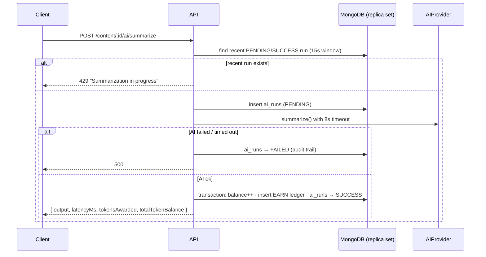

# Tongston T-Cell — Content, AI Summarization & Tokenized Rewards

A production-minded implementation of the **Tongston T-Cell** assessment: a Node/Express + MongoDB API that turns user content into AI summaries, pays for the work with a **token ledger**, and exposes a React admin UI for the full flow.

| Piece | Stack |
|---|---|
| **Backend API** | Node 20+, Express 4, TypeScript, Mongoose 8, Zod, Pino, Jest |
| **Frontend** | React 18, Vite 5, TypeScript, Tailwind 3, TanStack Query 5, Zustand, Axios |
| **Database** | MongoDB Atlas (replica set) — required for multi-document transactions |
| **AI** | `AIProvider` abstraction — `MockAIProvider` (default) with an `OpenAIProvider` slot |
| **Storage** | `StorageProvider` abstraction — Cloudinary (primary) → S3 (promotion) → mock |

**Domain analogy**

- **Content** — what users write (the "T-World" side, Notion/LMS-like).
- **T-Cell** — the AI brain that summarises content into work product.
- **Tokens (TOK)** — loyalty points earned for using the AI, convertible to `MOCK_USDT` / `MOCK_ETH` to simulate a Web3 economy. No real chain, but the money maths is real.

**Three personas, one codebase**

1. **Backend owner** — reliable APIs, clean data, no money bugs, traceable AI runs.
2. **End user** — click *Summarize*, see the result and *"You earned 5 tokens!"* instantly.
3. **Hiring manager** — API ownership, MongoDB modelling, storage abstraction, AI failure handling, ledger immutability.

---

## Architecture

```mermaid
flowchart LR
    subgraph Client["React Admin UI (Vite)"]
        UI[Pages<br/>Content · Summarize · AI Runs · Tokens]
        ST[(Zustand<br/>auth + balance)]
        RQ[TanStack Query<br/>server state]
    end

    subgraph API["Express API (/api/v1)"]
        MW[Helmet · CORS · Pino<br/>Rate limiters · Zod]
        AUTH[JWT auth + RBAC]
        CTL[Controllers]
        SVC[Services<br/>AIService · TokenService<br/>IdempotencyService]
    end

    subgraph Providers["Swappable providers"]
        AIP[AIProvider<br/>Mock / OpenAI]
        STP[StorageProvider<br/>Cloudinary / S3 / Mock]
    end

    DB[(MongoDB Atlas<br/>replica set)]
    EXT[Cloudinary · S3<br/>OpenAI (optional)]

    UI --> RQ -->|axios + Bearer JWT| MW
    UI <--> ST
    MW --> AUTH --> CTL --> SVC
    SVC --> AIP
    SVC --> STP
    SVC -->|transactions| DB
    AIP -.-> EXT
    STP -.-> EXT
```

**Request path for the money flow** (`POST /content/:id/ai/summarize`):



---

## Repository layout

```text
Tongston-Task/
├── backend/                     # Express + Mongoose API
│   ├── src/
│   │   ├── config/              # env, db, logger
│   │   ├── controllers/         # auth, content, ai, token, media
│   │   ├── middleware/          # authenticate, validate, rateLimit, idempotency, errorHandler
│   │   ├── models/              # user, content, ai_run, token_transaction, contract_conversion, media_asset, idempotency_key
│   │   ├── routes/              # /auth /content /ai /tokens /media
│   │   ├── services/            # ai/ (provider + ai.service), token.service, storage.service, idempotency.service
│   │   ├── scripts/seed.ts      # admin@test.com / user@test.com (bcrypt-hashed)
│   │   ├── utils/               # errors, response, crypto, asyncHandler
│   │   ├── app.ts               # express app wiring
│   │   └── server.ts            # entrypoint
│   └── .env.example
├── frontend/                    # React admin UI
│   ├── src/
│   │   ├── api/client.ts        # axios instance + typed endpoints
│   │   ├── components/          # Layout (sidebar/topbar) + ui/ primitives
│   │   ├── hooks/useApi.ts      # TanStack Query hooks
│   │   ├── pages/               # ContentList · CreateContent · ContentDetail · AIRuns · Tokens · Login
│   │   ├── store/index.ts       # Zustand auth + balance (localStorage persisted)
│   │   └── types/               # shared API types
│   └── vite.config.ts           # /api proxy → :3000
├── eslint.config.mjs            # shared ESLint 10 flat config
└── package.json                 # npm workspaces + concurrently
```

---

## Quick start

### Prerequisites

- **Node 20+** and npm 10+
- A **MongoDB Atlas M0** cluster (free tier). Atlas is a replica set, which is what makes MongoDB transactions work — see *Production Consideration 1*.

### 1. Install

```bash
git clone https://github.com/Easysoul1/Tongston-Task.git
cd Tongston-Task
npm install            # installs both workspaces
```

### 2. Configure the backend

```bash
cp backend/.env.example backend/.env
```

Then fill in `backend/.env`:

```dotenv
# MUST be Atlas (replica set) — standalone mongod cannot run transactions
MONGO_URI=mongodb+srv://<user>:<password>@<cluster>.mongodb.net/tongston?retryWrites=true&w=majority

JWT_SECRET=<a long random string>
CORS_ORIGIN=http://localhost:5173
PORT=3000

# Optional — the app runs fully on mocks without these
CLOUDINARY_CLOUD_NAME=...      # media upload
CLOUDINARY_API_KEY=...
CLOUDINARY_API_SECRET=...
AWS_ACCESS_KEY_ID=...          # media promotion to S3
AWS_SECRET_ACCESS_KEY=...
AWS_REGION=us-east-1
AWS_S3_BUCKET=...
AI_API_KEY=...                 # leave unset to use MockAIProvider
```

> **Never commit `.env`.** Only `.env.example` is tracked, and the repo ignores every other `.env*` file.

**Whitelist your IP.** Atlas rejects connections from unlisted addresses with `MongooseServerSelectionError` / `ReplicaSetNoPrimary`. Add your egress IP under *Network Access* in the Atlas console (`0.0.0.0/0` is acceptable for a local dev box, never for production).

### 3. Seed and run

```bash
npm run seed     # creates admin@test.com / admin123 and user@test.com / user123
npm run dev      # starts backend (:3000) and frontend (:5173) together
```

Open <http://localhost:5173> and sign in with `admin@test.com` / `admin123`.

| Script | What it does |
|---|---|
| `npm run dev` | backend (`tsx watch`) + frontend (Vite) concurrently |
| `npm run build` | type-check + build both workspaces |
| `npm run lint` | ESLint 10 flat config across both workspaces |
| `npm test` | Jest suite for the token ledger |
| `npm run seed` | seed the two demo users |
| `npm start` | run the compiled backend (`dist/server.js`) |

### 4. Verify it works

```bash
curl http://localhost:3000/api/v1/health
# {"success":true,"data":{"status":"ok","timestamp":"..."}}
```

---

## API

Every endpoint returns the same envelope, so clients never have to guess:

```json
{ "success": true, "data": { }, "error": { "code": "CONFLICT", "message": "Insufficient tokens. You have 4, tried 10" } }
```

| Endpoint | Method | Body / Query | Auth | Rate limit |
|---|---|---|---|---|
| `/api/v1/health` | GET | — | — | general (IP) |
| `/api/v1/auth/register` | POST | `{email, password, role?}` | — | general (IP) |
| `/api/v1/auth/login` | POST | `{email, password}` | — | general (IP) |
| `/api/v1/content` | POST | `{title, body, tags?}` | ✅ | general (IP) |
| `/api/v1/content` | GET | `?tag&q&page&limit` | ✅ | general (IP) |
| `/api/v1/content/:id` | GET | — | ✅ | general (IP) |
| `/api/v1/content/:id/ai/summarize` | POST | `{tone, length, promptVersion?}` | ✅ | **user-id (5/min)** |
| `/api/v1/ai/runs` | GET | `?page&limit` | ✅ | general (IP) |
| `/api/v1/tokens/balance` | GET | — | ✅ | general (IP) |
| `/api/v1/tokens/history` | GET | `?page&limit` | ✅ | general (IP) |
| `/api/v1/tokens/convert` | POST | `{toAsset, amount}` | ✅ | **user-id (10/min)** |
| `/api/v1/tokens/withdraw` | POST | `{amount, destination}` | ✅ | idempotency-key aware |
| `/api/v1/media/upload` | POST | multipart `file` | ✅ | general (IP) |
| `/api/v1/media/:id/promote` | POST | — | ✅ | general (IP) |

<details>
<summary>Example: the full loop with curl</summary>

```bash
# 1. Login
TOKEN=$(curl -s -X POST http://localhost:3000/api/v1/auth/login \
  -H "Content-Type: application/json" \
  -d '{"email":"admin@test.com","password":"admin123"}' | jq -r .data.token)

# 2. Create content
curl -X POST http://localhost:3000/api/v1/content \
  -H "Authorization: Bearer $TOKEN" -H "Content-Type: application/json" \
  -d '{"title":"My Article","body":"Long form content...","tags":["tech"]}'

# 3. Summarize it -> earns 5 TOK
curl -X POST http://localhost:3000/api/v1/content/<contentId>/ai/summarize \
  -H "Authorization: Bearer $TOKEN" -H "Content-Type: application/json" \
  -d '{"tone":"professional","length":"medium"}'

# 4. Check balance and ledger
curl http://localhost:3000/api/v1/tokens/balance -H "Authorization: Bearer $TOKEN"
curl http://localhost:3000/api/v1/tokens/history -H "Authorization: Bearer $TOKEN"

# 5. Convert TOK -> MOCK_USDT (mock tx hash returned)
curl -X POST http://localhost:3000/api/v1/tokens/convert \
  -H "Authorization: Bearer $TOKEN" -H "Content-Type: application/json" \
  -d '{"toAsset":"MOCK_USDT","amount":5}'

# 6. Withdraw TOK to an address
curl -X POST http://localhost:3000/api/v1/tokens/withdraw \
  -H "Authorization: Bearer $TOKEN" -H "Content-Type: application/json" \
  -d '{"amount":2,"destination":"0x1234567890abcdef1234567890abcdef12345678"}'
```

</details>

### Error semantics

| Status | Meaning |
|---|---|
| 400 | Malformed input / invalid ObjectId / rejected upload type |
| 401 | Missing or invalid JWT |
| 403 | Authenticated but wrong role |
| 404 | Resource not found |
| 409 | Conflict — insufficient balance, idempotency key reused with a different payload or still in flight |
| 413 | Upload larger than the 10 MB limit |
| 422 | Zod validation failure |
| 429 | Rate limited, or the 15s AI idempotency window is still open |
| 500 | Server error (internals are logged, never returned) |

One central error handler maps `ZodError → 422`, malformed ids → `400`, upload errors → `400/413`, and rate-limit errors → `429`. Messages from 5xx failures are never echoed to the client — provider and database internals stay in the logs. Every request is logged by Pino with a request id and, when authenticated, the user id.

---

## Data models & indexes

All schemas use `timestamps: true` and declare their indexes explicitly.

| Model | Purpose | Indexes |
|---|---|---|
| **users** | Account + token balance | `email` unique; `role`; `tokenBalance` default 0 |
| **content_items** | User content | `tags`; `createdBy`; text index on `title + body` (search) |
| **ai_runs** | One row per AI attempt — the audit trail | `contentId + userId + createdAt` (idempotency window); `contentId`; `userId` |
| **token_transactions** | **Immutable** ledger — inserts only, never updated or deleted | `userId + createdAt` desc |
| **contract_conversions** | Mock on-chain conversion records | `userId + createdAt` desc; `txHashMock` |
| **media_assets** | Upload/promotion state | `status`; `cloudinaryPublicId` |
| **idempotency_keys** | Request fingerprints + stored responses | `key` unique; 7-day TTL |

**Ledger rules (why the money maths is safe)**

- `token_transactions` is an **append-only** audit log: `EARN` is positive, `CONVERT`/`WITHDRAW` are negative, and every row stores `balanceAfter` so history can be replayed.
- The user's `tokenBalance` is a **denormalised cache** of the ledger; every mutation happens inside a MongoDB transaction together with its ledger row, so the two can never drift.
- A withdrawal records the `destination` address on the ledger row, so every outbound movement is attributable.

---

## AI provider abstraction

```ts
export interface AIProvider {
  summarize(input: AIProviderRequest): Promise<AIProviderResponse>;
}
```

- `MockAIProvider` (default) — deterministic output, awards 5 TOK. The whole app runs with zero external credentials.
- `OpenAIProvider` — the production slot; selected automatically by `getProvider()` when `AI_API_KEY` is a real key (not the placeholder, length > 20).
- The service layer never imports a concrete provider — swapping vendors is a one-line change.
- Every call is wrapped in an 8-second `Promise.race` timeout; a timeout marks the `ai_run` `FAILED` instead of leaving it hanging.

---

## Token ledger: preventing double spend and double charges

**Double spend** (spending the same balance twice concurrently) is prevented by doing the read-check and the write in **one MongoDB transaction**:

```ts
await session.withTransaction(async () => {
  const user = await User.findById(userId).session(session).select('tokenBalance');
  if (user.tokenBalance < amount) throw AppError.conflict(`Insufficient tokens. You have ${user.tokenBalance}, tried ${amount}`);
  const newBalance = user.tokenBalance - amount;
  await User.updateOne(...).session(session);                    // deduct
  await TokenTransaction.create([...], { session });             // ledger row
  await ContractConversion.create([...], { session });           // mock contract
});
```

Two concurrent converts both read the same starting balance inside their own snapshot; the second transaction fails to commit on the write conflict, so the balance can never go negative.

**Double charge** (the same AI work paid twice) is prevented by two mechanisms:

1. **15-second AI idempotency window** — before creating a `PENDING` run, the API looks for a recent `PENDING`/`SUCCESS` run for the same `(contentId, userId)` and returns `429`. The React UI mirrors this by disabling the Summarize button for 15 seconds with a live countdown.
2. **`Idempotency-Key` header contract** — the client may send a stable key per intent; the key is claimed atomically through a unique index (no SELECT-then-INSERT race), the response is stored, and a retry replays the stored response. Reusing a key with a different payload fails loudly with `422`.

---

## Storage flow

```text
POST /media/upload      → multer memoryStorage → StorageProvider.upload(buffer)
                         → CloudinaryStorage (if creds) else MockStorage
                         → media_assets row (status CLOUDINARY)

POST /media/:id/promote → idempotent: already S3 → return existing record
                         → S3Storage.upload() when AWS creds exist, else mock://promote
                         → media_assets row updated to status S3
```

Both providers implement the same `StorageProvider` interface (`upload(buffer, originalName) → {url, key}`), so the controller never knows which backend is in play. Uploads are streamed through memory rather than the local filesystem, so the API stays stateless and deployable.

---

## Production considerations — the 5 critical fixes

### 1. MongoDB transactions require a replica set

**Issue.** `session.startTransaction()` throws `Transaction numbers are only allowed on a replica set member` on a standalone local `mongod`. Every token mutation would fail at runtime.

**Fix.** The project uses **MongoDB Atlas M0 from day one** — Atlas is a replica set by default, so transactions work. `backend/src/config/db.ts` warns at boot when `MONGO_URI` points at `localhost` without a `replicaSet` parameter, so the failure mode is explained instead of mysterious.

> Uses Atlas for transaction support. All token updates use `mongoose.startSession()` with a replica set.

### 2. AI side-effects vs database transactions

**Issue.** The AI call is an external side-effect. If the provider succeeds (tokens were "spent" upstream) but the database transaction then fails, the system has paid for work it never recorded — or, worse, recorded work it never paid for.

**Fix — the PENDING pattern:**

1. Insert `ai_runs` with status `PENDING` **outside** any transaction (it is a fact about an attempt, not a balance).
2. Call the AI provider with an 8-second timeout.
3. Only then open a transaction: increment `users.tokenBalance`, insert the `EARN` ledger row, update the run to `SUCCESS` with `output` / `latencyMs` / `tokensAwarded`.

If step 3 fails, the run is marked `FAILED` **outside** the transaction so the audit trail still records the attempt, and the client receives a 500. The provider call is never inside a transaction — a long-running external call inside a transaction holds locks and can exhaust the transaction lifetime limit.

> In production I would decouple this with BullMQ/Redis: an AI job queue, a worker that calls the provider, and a `TokenSettlement` job published on success. That gives exactly-once processing, retry with backoff, and horizontal scaling of AI work. For this assessment the PENDING pattern captures the same consistency guarantee without the extra infrastructure.

### 3. Idempotency on the AI endpoint

**Issue.** A double-click (or a client retry) creates two AI runs and pays 10 tokens for one piece of work.

**Fix.** A guard runs *before* the `PENDING` insert: if a `PENDING`/`SUCCESS` run exists for the same `(contentId, userId)` within the last 15 seconds, the API returns `429` and nothing is charged. Fifteen seconds is long enough to absorb an impatient double-click and short enough not to block genuine re-runs. The composite index `ai_runs.contentId + userId + createdAt` keeps the lookup a single indexed scan. The UI mirrors the window with a disabled button and countdown, so the constraint is visible instead of mysterious.

### 4. Zod validation for MongoDB ObjectIds

**Issue.** `GET /content/123` reaches Mongoose and dies with a `CastError`, surfacing as a 500 for what is really a client mistake.

**Fix.** Validation happens at the route boundary, in two layers. `validateObjectIdParam()` checks every `:id` path parameter against `mongoose.Types.ObjectId.isValid()` before a controller runs, so a bad id becomes a clean `400`. Behind it, the central error handler still maps any `CastError` / `BSONError` to `400`, so no future route can leak a 500 for malformed input. Bodies and query strings are parsed by the shared Zod schemas in `backend/src/schemas/common.schema.ts` (`createContentSchema`, `aiSummarizeBodySchema`, `convertBodySchema`, `withdrawBodySchema`, `paginationQuerySchema`), and the controllers consume the parsed result instead of re-parsing. Input validation happens only at the edges — never between internal functions.

### 5. Rate limiting by user, not IP

**Issue.** `express-rate-limit` keys on IP by default. Under university or corporate NAT, dozens of users share one IP, so a single heavy user exhausts the quota for everyone behind that gateway.

**Fix.** The AI and token-conversion limiters run **after** `authenticate`, keyed on `req.user.id`. The general limiter stays IP-based for unauthenticated routes where there is no user id yet. I considered IP + user as a composite key, but pure user-keying is the stricter and simpler guarantee for the routes that matter.

### Idempotency contract

- The client supplies an `Idempotency-Key` header once per intent and reuses it on retries.
- The key is claimed atomically via a unique constraint — never SELECT-then-INSERT, which races.
- Same key + different payload → `422` (`IDEMPOTENCY_KEY_REUSED`), failing loudly rather than silently doing the wrong thing.
- An in-flight duplicate → deliberate `409`, so the client retries later.
- Keys carry a 7-day TTL, which must outlive the longest retry path.

---

## Testing

```bash
npm test
```

The Jest suite covers the three properties that matter most for a token system:

- `rejects conversion exceeding balance` — you cannot spend what you do not have.
- `completes conversion within balance atomically` — balance, ledger row and contract record move together.
- `service uses insert-only ledger pattern` — there is no update path for `token_transactions`.

Quality gates for the whole repo:

```bash
npm run lint     # ESLint 10 flat config, both workspaces
npm run build    # tsc + vite build
```

---

## CI

`.github/workflows/ci.yml` runs install → lint → build → test on every push and pull request, so a broken build never reaches `main`.

---

## Deployment

| Service | Target | Notes |
|---|---|---|
| Backend | Render (or any Node host) | `npm run build && npm start`, `MONGO_URI` + `JWT_SECRET` as env vars |
| Frontend | Vercel (or any static host) | `npm run build` in `frontend/`, set `VITE_API_BASE_URL` to the API origin |

> **Live URLs:** not deployed for this submission — the repository is the deliverable. Follow the table above to deploy; no credentials are required to run locally thanks to the mock AI and storage providers.

---

## Future improvements

- **BullMQ + Redis for AI settlement** (Fix 2): move the AI call and token settlement into a durable queue for exactly-once processing, retry with backoff, and horizontal scaling of AI work. Redis also backs the idempotency-key store so it survives restarts and works across API instances.
- **Real `OpenAIProvider`**: implement the chat-completions call with prompt versioning, token accounting, and per-tenant prompt templates.
- **Real withdrawal adapter**: the mock settlement is a ledger row plus a fake tx hash; a real implementation would sign a transfer and reconcile it against a chain indexer.
- **Rate-limit store**: move `express-rate-limit` counters to Redis so limits are shared across instances.
- **Observability**: OpenTelemetry traces, Prometheus metrics for AI latency and settlement failures, and alerting on ledger-vs-balance drift.

---

## Assumptions & open questions

- The AI provider is **mock-first**: the assessment runs with zero external credentials; a real key flips `getProvider()` automatically.
- The Web3 side is **simulated**. `MOCK_USDT` / `MOCK_ETH` are ledger entries with realistic `0x` + 64-hex transaction hashes generated by `crypto.randomBytes`, not on-chain transfers.
- Transactions require Atlas or a configured single-node replica set — a stock local `mongod` cannot run them.
- Media promotion falls back to a mock S3 record when AWS credentials are absent.

---

## Disclosure

*Used AI for planning and code assistance; the implementation, structure and decisions are my own.*
